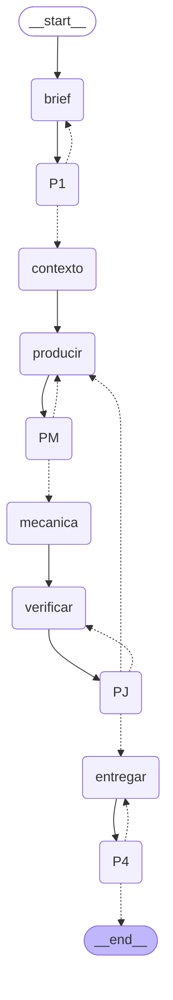
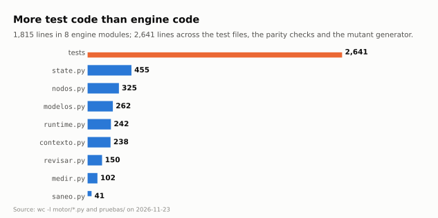

# sistema-produccion

A small engine that makes language-model output pass a mechanical check, a cold review and a human gate before it ships, with every approval tied to the content by hash.

<p align="center">
  <picture>
    <source media="(prefers-color-scheme: dark)" srcset="docs/img/kpis-dark.svg">
    
  </picture>
</p>

The figure summarizes four checks: 303 offline tests pass in 7 seconds; the test suite catches 194 of 194 mutants (deliberate bugs injected into controls to verify that tests fail); a reviewer test on one piece in one run caught 6 of 6 seeded errors (planted mistakes) and invented none; and 4 model routes (provider connectors), one function each. Source: `docs/figuras/generar.py`.

## The problem

- Unreviewed output can reach a reader. The pipeline (called a line) requires a mechanical check (pattern rules run by code) and a cold verifier (a reviewer model from a separate family) before delivery, plus a human gate (a pause for human sign-off) before final delivery. Source: `motor/runtime.py`, `motor/nodos.py`, `docs/grafos/bloque-15.md`.
- Cut responses can pass as complete text. In a real run, every long response died at 60 seconds across eleven straight drops; now a stream without `[DONE]` fails. Source: development notes, not included here.
- Approvals can outlive edited files. Records store the `sha256` hash (content fingerprint) of the approved text; if the file changes, that stage and all later stages expire. Source: `motor/state.py`, `pruebas/mutantes/mutar.py`.
- A writer model can review itself. Here DeepSeek writes and Claude runs the cold review, using different model families. Source: `motor/nodos.py`.
- Private data can leave to an external provider. A filter blocks the send before the call. It stops obvious cases and does not guarantee anonymization. Source: `motor/modelos.py`.
- Per-role costs go untracked. `medir.py` sums tokens, cost, drops, and rounds by stage, role, and model from the manifests (on-disk records written at each stage). Source: development notes, not included here.

## How it works

The engine generated this diagram with `runtime.dibujar` from the line of the instance that produces this README.



Lowercase boxes are work steps run by a script or a model. `P1`, `PM`, `PJ`, and `P4` are gates where the flow pauses until a person decides. Dotted arrows depend on that person's decision or on review findings. `PM` stops only if the piece carries a gate mark: a missing source, a gap in the brief, or an item still to be verified. `PJ` stops only if the verifier found an issue needing human judgement. Findings are M (mechanical), R (rule) or J (human judgement). M and R can send the piece back to `producir` with at most two verification runs. `Limits` lists a known bug in this loop.

## Six design decisions

| Decision | Problem it solves | Where it lives | Test that backs it |
|---|---|---|---|
| The truth is in the files | State must survive deleting the checkpoint (local resume database) | `motor/runtime.py`, `motor/state.py`, the manifests | Mutants for "manifest seal is not checked", "chain does not check previous or sequence", and "registers with broken chain" are detected in `pruebas/mutantes/mutar.py` |
| No model chooses routes | Models must not decide step order or correction rounds | `motor/runtime.py` line 3, `motor/state.py` (`validar_linea`, `max_rondas`) | `pruebas/test_state.py` rejects a stage depending on a later stage, a repeated gate, a conditional stage without a gate, and gates without approvers; max rounds is two in tests and the real run |
| The writer is not the reviewer | A model should not review its own draft | `motor/nodos.py` (`borrador`, `verificador`), `motor/modelos.py` | `pruebas/test_borrador.py` (`test_solo_deepseek_escribe`) requires any other writer route to raise `Bloqueado`. DeepSeek wrote the draft of this README and Claude reviewed it |
| What leaves to a model passes through a filter | Private data could be sent to an external provider | `motor/modelos.py` (`llamar`), `motor/saneo.py` (`exigir_limpio`) | Block 12 records 64 of 64 mutants detected. Source: development notes, not included here |
| An approval is tied to content | An approval could survive edits to the approved file | `motor/state.py`, `motor/runtime.py` (`decidir`) | Expiry of changed content is covered in `pruebas/test_state.py`; `pruebas/mutantes/mutar.py` breaks the approval controls |
| A control is tested by injecting the error it watches | Each control must prove it catches the exact error it exists to stop | Mechanical review has 14 rules | Each of the 14 rules has an error case that fires and a clean case that does not. Source: development notes, not included here |

## Evidence

<p align="center">
  <picture>
    <source media="(prefers-color-scheme: dark)" srcset="docs/img/cost-dark.svg">
    
  </picture>
</p>

One real run with two versions of the piece cost 0.73 US dollars API-equivalent for reviewers and 0.15 US dollars billed for the writer. Source: development notes, not included here.

<p align="center">
  <picture>
    <source media="(prefers-color-scheme: dark)" srcset="docs/img/loop-dark.svg">
    
  </picture>
</p>

In that run, round 1 had 8 findings returned to the writer and 1 needing a person; round 2 had 2 and 1. Source: development notes, not included here.

<p align="center">
  <picture>
    <source media="(prefers-color-scheme: dark)" srcset="docs/img/code-dark.svg">
    
  </picture>
</p>

Line counts are 2,641 in tests and eight engine files from `state.py` at 455 down to `saneo.py` at 41. Source: `wc -l motor/*.py`.

The real run with quota on 7 November 2026 exposed two faults in the DeepSeek route: one cut response escaped as a raw exception, and every long response cut off at 60 seconds across eleven drops in a row. The route now requests streaming, and a stream without `[DONE]` fails instead of passing truncated text. Source: development notes, not included here.

In the verifier test with six seeded errors (one piece, one run), the verifier caught all six, invented no findings, and repeated in the seeded version what it had found in the clean one. It also exposed a judgement problem: the verifier marked 6 of 7 class R findings as already-corrected errors because the context carried rule history. Repeat detection moved to the engine, which now compares class, rule, and place against the previous round. Source: `motor/nodos.py` (`repetidos`).

## What you can plug in

| Extension point | What you connect | What you write | File |
|---|---|---|---|
| A new model | Any provider behind a `Pedido -> Respuesta` function | Register the function in `VIAS`; four exist (`deepseek`, `claude`, `opencode`, `ollama`) | `motor/modelos.py` |
| A new step | Any `Contexto -> Resultado` function, script, or model | Wrap it in a `Nodo`; the runtime writes outputs, records the manifest, and skips valid stages | `motor/runtime.py` |
| Rules for a new domain | Piece types and per-role rule files | Declare them in `instancia.toml`; mechanical rules are text lines with a pattern | `plantillas/instancia/`, `motor/contexto.py`, `motor/revisar.py` |
| Gates and cycles | Stages, dependencies, gates, approvers, and cycles | Declare them in a dictionary; `validar_linea` rejects late dependencies, repeated gates, conditional stages without a gate, and gates without approvers | `motor/state.py` |
| Fixed-shape reports | JSON outputs from the verifier and source verifier | Validate them before accepting (`validar_informe`, `validar_fuentes`) | `motor/nodos.py` |
| Web search for sources | Web sources through the `claude` route | Enable only `WebSearch` and `WebFetch` | `motor/modelos.py` |
| Resume | The SQLite checkpoint | Nothing; the checkpoint can be deleted because the truth is in the files | `motor/runtime.py` |

## Limits

- A clean report does not prove there are no errors.
- Cost, round, and seeded-error figures each come from a single real test.
- Known bug: returning from the conditional gate after `verificar` re-runs the verifier on the same piece instead of sending it back to the writer, using up a round (`motor/runtime.py`). Found while producing this README.
- A stage whose rules changed gives a warning and is not redone, so a reviewer can judge with an old rules package. Found in the same run.
- Gate observations enter the model prompt as plain text, and approval records do not distinguish who decided from who ran the command.
- Code, comments, and templates are in Spanish. Development audit sheets are not included in this sample.
- The graph is sequential: there are no parallel nodes (`Send`) and no agent panel inside the engine. Source: `motor/runtime.py`.
- No supervisor agent decides routing; step order lives in the program by design. Source: `motor/runtime.py`, line 3.
- A panel of several creative voices existed in the first instance, but it ran by hand outside the engine.
- The engine runs on the author's machine without Docker and has not been deployed to the cloud; AWS was left as a future direction to evaluate with user feedback.
- There is a single human approver; end-to-end tests signed gates with a declared test approver.
- The cold verifier runs on a single model family, Claude.
- Capture and video block repositories (audio, frames, and editing) are not in this engine.

## Future work

These are proposals, not commitments, and none of them is built.

1. Parallel verifiers from different model families could run as LangGraph fan-out nodes and merge reports by rule, building on the new-step extension point and the checkpoint in `motor/runtime.py`.
2. A supervisor with bounded routes could choose only among declared line edges, keeping step order in the program via `validar_linea` in `motor/state.py`.
3. A quality-control stage could run `pytest` and the mutant suite and stop the line if any mutant survives, applying the engine to code via the new-step extension point and fixed-shape reports.
4. Instances for other domains could review agent-generated diffs, technical documentation, or release notes using `instancia.toml` and the mechanical rules in `motor/revisar.py`.
5. A per-instance evaluation bench could use reference cases and seeded errors to measure verifier recall across prompt changes, starting from the six-seeded-error run and building on fixed-shape reports and `motor/nodos.py`.
6. External tools with minimal permissions could connect CRM, databases, or documents behind the same filter with only declared permissions, building on `motor/modelos.py`, `motor/saneo.py`, and the new-step extension point.
7. A spending-cap gate could turn `medir` (`motor/medir.py`) from measurement into a gate declared in `motor/state.py` that stops the line.
8. Cloud deployment with several approvers could be evaluated with user feedback, building on gates and cycles and addressing the single-approver limit in `Limits`.

## Run it

```bash
/usr/bin/python3.12 -m venv .venv
.venv/bin/pip install --require-hashes -r requirements.lock
.venv/bin/pip install pytest
.venv/bin/pytest
.venv/bin/python pruebas/mutantes/mutar.py
python3 docs/figuras/generar.py
```

## How this README was made

Drafted with the engine, then corrected by hand with Claude Code; it did not complete the full gate sequence.
