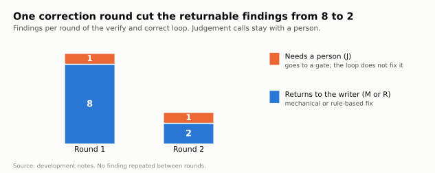

# sistema-produccion

A small engine that makes language-model output pass a mechanical check, a cold review and a human gate before it ships, with every approval tied to the content by hash.

<p align="center">
  <picture>
    <source media="(prefers-color-scheme: dark)" srcset="docs/img/kpis-dark.svg">
    
  </picture>
</p>

The figure shows the test run, the mutant run, the result of one seeded-error test (one piece, one run) and the number of model routes. Source: `docs/figuras/generar.py`.

## The problem

- A model output can reach a reader without anyone reviewing it. The line requires a mechanical check and a cold verifier before delivery, and a human gate before final delivery. Source: `motor/runtime.py`, `motor/nodos.py`, `docs/grafos/bloque-15.md`.
- A cut response can be accepted as text. In a real run every long response was cut at 60 seconds, with eleven drops in a row; now a stream without `[DONE]` fails. Source: development notes, not included here.
- An approval can survive what it approved. The record carries the sha256 of the approved content; if the file changes, the stage and everything after it expires. Source: `motor/state.py`, `pruebas/mutantes/mutar.py`.
- The writer can review itself. The writer is DeepSeek and the cold reviewer is Claude, from different families. Source: `motor/nodos.py`.
- Private data can leave to an external provider. The sanity filter stops the send before the call; the block 12 sheet states that this is a brake for obvious cases, not a guarantee of anonymization. Source: `motor/modelos.py`.
- Nobody knows how much each role costs. `medir.py` sums tokens, cost, drops and rounds by stage, role and model from the manifests. Source: development notes, not included here.

## How it works

The engine generated this diagram with `runtime.dibujar` from the line of the instance that produces this README.


Boxes named after a step are work, done by a script or a model. `P1`, `PM`, `PJ` and `P4` are gates where the flow stops until a person decides. A dotted arrow depends on what the person decided or on what the review found. `PM` stops only if the piece carries one of the marks that go to a gate: a missing source, a gap in the brief, or something still to be verified. `PJ` stops only if the verifier found something that needs judgement. Findings of class M or R can send the piece back to `producir`, two verification runs at most. `Limits` lists a known bug in this loop.

## Six design decisions

| Decision | Problem it solves | Where it lives | Test that backs it |
|---|---|---|---|
| The truth is in the files | State must survive a deleted checkpoint | `motor/runtime.py`, `motor/state.py`, the manifests | Mutants for "manifest seal is not checked", "chain does not check previous or sequence", and "registers with broken chain" are detected in `pruebas/mutantes/mutar.py` |
| No model chooses routes | A model must not decide the order of steps or the number of correction rounds | `motor/runtime.py` line 3, `motor/state.py` (`validar_linea`, `max_rondas`) | `pruebas/test_state.py` rejects a stage that depends on a later stage, a repeated gate, a conditional stage without a gate, and a line with gates without approvers; the maximum rounds is two in tests and in the real run |
| The writer is not the reviewer | A model should not review its own output | `motor/nodos.py` (`borrador`, `verificador`), `motor/modelos.py` | `pruebas/test_borrador.py` (`test_solo_deepseek_escribe`) requires any other writer route to raise `Bloqueado`. The draft of this README was written by DeepSeek and reviewed by Claude |
| What leaves to a model passes through a filter | Private data could be sent to an external provider | `motor/modelos.py` (`llamar`), `motor/saneo.py` (`exigir_limpio`) | Block 12 records 64 of 64 mutants detected. Source: development notes, not included here |
| An approval is tied to content | An approval could survive changes to the file that was approved | `motor/state.py`, `motor/runtime.py` (`decidir`) | Expiry of changed content is covered in `pruebas/test_state.py`; `pruebas/mutantes/mutar.py` breaks the approval controls |
| A control is tested by injecting the error it watches | A control must show that it catches the exact error it exists to stop | Mechanical review has 14 rules | Each of the 14 rules has a case with the error, which fires, and a clean case, which does not. Source: development notes, not included here |

## Evidence

<p align="center">
  <picture>
    <source media="(prefers-color-scheme: dark)" srcset="docs/img/cost-dark.svg">
    
  </picture>
</p>

The chart shows 0.73 US dollars API-equivalent for reviewers and 0.15 US dollars billed for the writer in one real run with two versions of the piece. Source: development notes, not included here.

<p align="center">
  <picture>
    <source media="(prefers-color-scheme: dark)" srcset="docs/img/loop-dark.svg">
    
  </picture>
</p>

The chart shows 8 findings returned to the writer and 1 needing a person in round 1, and 2 and 1 in round 2. Source: development notes, not included here.

<p align="center">
  <picture>
    <source media="(prefers-color-scheme: dark)" srcset="docs/img/code-dark.svg">
    
  </picture>
</p>

The chart shows the line counts in the figure: tests 2,641 and the eight engine files from `state.py` at 455 down to `saneo.py` at 41. Source: `wc -l motor/*.py`.

The real run with quota on 7 November 2026 found two faults in the DeepSeek route. One cut response escaped as a raw exception, and every long response was cut at 60 seconds, with eleven drops in a row. The route now asks for streaming, and a stream without `[DONE]` fails instead of being accepted truncated. Source: development notes, not included here.

The verifier test with six seeded errors caught the six and invented no findings, and what it found in the clean version it repeated in the seeded one. This was one piece and one run. It also exposed a judgement problem: the verifier marked 6 of 7 R findings as already-corrected errors because the context carried the history of the rules. The decision moved to the engine, which now compares class, rule and place with the previous round. Source: `motor/nodos.py` (`repetidos`).

## What you can plug in

| Extension point | What you connect | What you write | File |
|---|---|---|---|
| A new model | Any provider behind a `Pedido -> Respuesta` function | Register the function in `VIAS`; four exist (`deepseek`, `claude`, `opencode`, `ollama`) | `motor/modelos.py` |
| A new step | Any `Contexto -> Resultado` function, script or model | Wrap it in a `Nodo`; the runtime writes its outputs, records the manifest, and skips what is still valid | `motor/runtime.py` |
| Rules for a new domain | Piece types and per-role rule files | Declare them in `instancia.toml`; mechanical rules are text lines with a pattern | `plantillas/instancia/`, `motor/contexto.py`, `motor/revisar.py` |
| Gates and cycles | Stages, dependencies, gates, approvers and cycles | Declare them in a dictionary; `validar_linea` rejects late dependencies, repeated gates, conditional stages without a gate, and gates without approvers | `motor/state.py` |
| Fixed-shape reports | JSON outputs from the verifier and source verifier | Validate them before accepting them (`validar_informe`, `validar_fuentes`) | `motor/nodos.py` |
| Web search for sources | Web sources through the `claude` route | Enable `WebSearch` and `WebFetch`, and nothing else | `motor/modelos.py` |
| Resume | The SQLite checkpoint | Nothing; the checkpoint can be deleted because the truth is in the files | `motor/runtime.py` |

## Limits

- A clean report does not prove there are no errors.
- Cost, round and seeded-error figures each come from a single real test.
- Known bug: returning the conditional gate after `verificar` runs the verifier again on the same piece instead of sending it back to the writer, and that uses up a round (`motor/runtime.py`). Found while producing this README.
- A stage whose rules changed gives a warning but is not redone, so a reviewer can judge with an old rules package. Found in the same run.
- The gate observation enters the model prompt as plain text, and an approval record does not distinguish who decided from who ran the command.
- Code, comments and templates are in Spanish. The development audit sheets are not included in this sample.

- The graph is sequential: there are no parallel nodes (`Send`) and no agent panel inside the engine. Source: `motor/runtime.py`.
- There is no supervisor agent that decides routing. That is a design decision: the order is in the program. Source: `motor/runtime.py`, line 3.
- A panel of several creative voices existed in the first instance, but it ran by hand outside the engine.
- The engine runs on the author's machine, without Docker, and has not been deployed to the cloud. AWS was left as a future direction, to be evaluated with user feedback.
- There is a single human approver. The end-to-end tests signed the gates with a declared test approver.
- The cold verifier runs on a single model family, Claude.
- The capture and video block repositories, audio, frames and editing, are not in this engine.

## Future work

These are proposals, not commitments, and none of them is built.

1. A panel of parallel verifiers from different model families could run inside the graph as LangGraph fan-out nodes, with the reports merged by rule. It would build on the new-step extension point and on the checkpoint in `motor/runtime.py`.
2. A supervisor with bounded routes could choose only among the edges that the line declares, so the order remains in the program. It would build on `validar_linea` in `motor/state.py`.
3. The engine's own quality control could become a stage that runs `pytest` and the mutant suite and stops the line if any mutant survives, to use the engine on code rather than only on text. It would build on the new-step extension point and on fixed-shape reports.
4. Instances for other domains could review agent-generated diffs, technical documentation or release notes, requiring only domain rules, domain tests and a manifest. They would build on `instancia.toml` and on the mechanical rules in `motor/revisar.py`.
5. A per-instance evaluation bench could use reference cases and seeded errors to measure verifier recall before and after each prompt change; the six-seeded-error run is the seed. It would build on fixed-shape reports and on `motor/nodos.py`.
6. External tools with minimal permissions could connect CRM, databases or documents as nodes behind the same sanity filter and with no more permissions than declared. They would build on `motor/modelos.py`, `motor/saneo.py` and the new-step extension point.
7. A spending cap as a gate could turn `medir` from measurement into a gate that interrupts the line. It would build on `motor/medir.py` and on the gate declarations in `motor/state.py`.
8. Cloud deployment with several approvers could be evaluated with user feedback. It would build on gates and cycles and on the single-approver limit described in Limits.

## Run it

```bash
/usr/bin/python3.12 -m venv .venv
.venv/bin/pip install --require-hashes -r requirements.lock
.venv/bin/pip install pytest
.venv/bin/pytest
.venv/bin/python pruebas/mutantes/mutar.py
python3 docs/figuras/generar.py
```

## How this README was made

The engine drafted it on a separate instance: DeepSeek wrote and Claude reviewed. The loop stopped at a gate because of the bug in `Limits`, so the last corrections were made by hand with Claude Code and the final gates were not signed. A coding agent executed the recorded gate decisions on the author's instruction.
