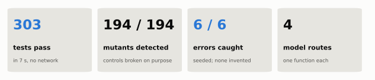
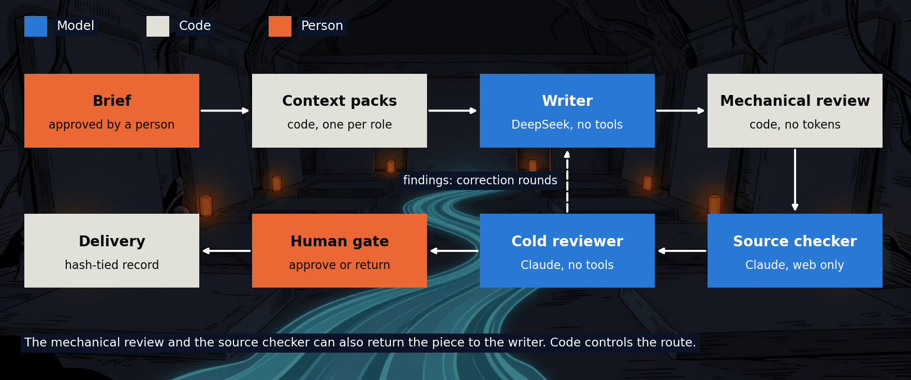
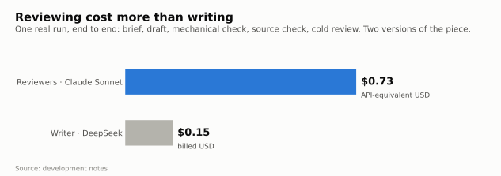

<p align="center"></p>

# sistema-produccion

**A multi-model production line: DeepSeek writes, Claude checks sources and reviews, code decides the route, and a person approves.**

It is the core of a larger system for producing PDFs, slide decks and videos. This repository publishes the core; the production modules stay private for now.

Language models write quickly but should not approve their own work. This engine gives each model one job and only the permissions that job needs. Every step leaves a record, and approvals are tied to the exact content by hash.

<p align="center">
  <picture>
    <source media="(prefers-color-scheme: dark)" srcset="docs/img/kpis-dark.svg">
    
  </picture>
</p>

## The pipeline

<p align="center"></p>

*A typical line. Each project declares its own stages, gates and correction rounds; LangGraph runs them in order.*

1. **Brief.** A person approves the assignment. The approval stores its sha256.
2. **Context.** Code builds a separate rules pack for each role, so each model receives only its own pack.
3. **Draft.** DeepSeek writes the piece. Missing information is marked instead of filled in, and goes to a person.
4. **Mechanical review.** Pattern rules catch what does not need a model. This step uses no tokens.
5. **Sources.** Claude opens the cited sources on the web and returns confirmed, corrected and unverifiable lists with URLs.
6. **Cold review.** Claude reads the piece without the writer's conversation and returns structured findings: M (mechanical), R (rule) or J (judgement). M and R can go back to the writer within a fixed number of rounds. J goes to a person.
7. **Delivery.** A person signs off. If approved content changes later, that approval and the later stages expire.

## The agents and their permissions

| Role | Runs on | Can do | Cannot do | Output |
|---|---|---|---|---|
| Context builder | Code | Read the files the project declares | Call a model | One pack per role |
| Writer | DeepSeek (`deepseek-v4-pro`) | Read its pack and write text | Use tools or review | Draft |
| Mechanical reviewer | Code | Apply pattern rules | Call a model | JSON report |
| Source checker | Claude Sonnet | `WebSearch` and `WebFetch` | Use a shell or write files | Validated JSON with URLs |
| Cold reviewer | Claude Sonnet | Read its pack and the piece | Use tools | Validated JSON findings |
| Router | Code (LangGraph) | Follow the declared stages | Let a model choose the route | Records and state |
| Approver | Person | Approve or return | Skip the record | Record tied to a hash |

Model names are the ones used in the recorded runs; they are set by each project. Four routes exist behind one interface: `deepseek`, `claude`, `opencode` (free models) and `ollama` (local). A step can list fallback routes, tried in order until one returns a valid result. Code: `motor/nodos.py`, `motor/modelos.py`.

## Design choices

| Choice | How it works | Code and tests |
|---|---|---|
| Code decides the route | A line declares stages, dependencies, gates and maximum rounds. Invalid lines are rejected | `motor/state.py`, `pruebas/test_state.py` |
| The writer is not the reviewer | Writing is limited to DeepSeek; the reviewer runs through Claude | `motor/nodos.py`, `pruebas/test_borrador.py` |
| Least privilege | Claude and opencode run in temporary folders. Claude can be given only two web tools | `motor/modelos.py`, `pruebas/test_modelos.py` |
| Outgoing data is checked | A filter stops a call to a non-local model when it finds private terms or known patterns | `motor/saneo.py`, `pruebas/test_saneo.py` |
| Files are the source of truth | Hash-sealed manifests rebuild the state; the LangGraph checkpoint can be deleted | `motor/state.py`, `motor/runtime.py` |
| Controls are tested by breaking them | 194 deliberate faults were injected and the tests detected all of them | `pruebas/mutantes/mutar.py` |
| Cost is measured | Tokens, cost, failures and rounds by stage, role and model | `motor/medir.py` |

## Results from real runs

<p align="center">
  <picture>
    <source media="(prefers-color-scheme: dark)" srcset="docs/img/cost-dark.svg">
    
  </picture>
</p>

In one end-to-end run with two versions of a piece, the writer cost 0.15 US dollars billed and the Claude reviews 0.73 US dollars API-equivalent.

<p align="center">
  <picture>
    <source media="(prefers-color-scheme: dark)" srcset="docs/img/loop-dark.svg">
    
  </picture>
</p>

In that run, findings to correct went from 8 in round 1 to 2 in round 2, with 1 for a person in each. In a separate test on one piece, the cold reviewer caught 6 of 6 planted errors and invented none. Run notes are not included in this sample.

Real runs also shaped the code: the DeepSeek route now streams and rejects a response that ends without `[DONE]`, and the engine, not the model, decides whether a finding is repeated.

## What you can plug in

| Add | By writing | Where |
|---|---|---|
| A model | One function, `Pedido -> Respuesta` | `motor/modelos.py` |
| A step | One function, `Contexto -> Resultado` | `motor/runtime.py` |
| A domain | An `instancia.toml` and its rule files | `plantillas/instancia/` |
| A gate or correction loop | A dictionary entry | `motor/state.py` |

## The larger production system

These modules exist in private projects and have been used there. Connecting them to this engine is ongoing work, so their code is not included.

| Module | What exists today | Evidence so far | Planned role here |
|---|---|---|---|
| PDFs | Markdown to PDF generator | Real documents produced | Delivery step |
| Slide decks | Decks as data with interchangeable themes, plus a visual check | Real decks produced | Delivery and review steps |
| Images | Batch generation through the ComfyUI API, with an image contract for decks | Both illustrations on this page | Image step with human selection |
| Tutorial videos | Screen recording to edited tutorial: transcription, script, voice and assembly, with gates | Rendered tutorials; automated tests | Video line |
| Animated video | Script to keyframes, clips, voice, music and export in two languages | A pilot episode exported in Spanish and English | Video line |

## Example output

[**A Fourier transform lecture**](examples/fourier-lecture/): instructions, notes, PDF, 13-slide deck, numerical checks and review history. It was made as a test with an earlier version of the system, before this engine.

<p align="center"><a href="examples/fourier-lecture/"></a></p>

## Uses: done and next

| Use | Already done | Next |
|---|---|---|
| Another domain | The Fourier lecture: different subject, language and type of error | Technical documentation and release notes |
| Parallel review | Two Claude reviewers, content and sources, run in parallel outside this engine | Parallel stages and different model families |
| Reviewer evaluation | One test with 6 planted errors | A bench that repeats it after each prompt change |
| Code quality | This engine's controls were tested with 194 mutants | Tests and mutants as a stage for agent-written diffs |
| Cost control | Tokens and cost measured per role | A spending limit that stops the line |
| Images | ComfyUI batches and images for decks | An image stage with a human gate |
| Business tools | Not started | CRM and databases behind the filter, with declared permissions |

## Run it

```bash
/usr/bin/python3.12 -m venv .venv
.venv/bin/pip install --require-hashes -r requirements.lock
.venv/bin/pip install pytest
.venv/bin/pytest
.venv/bin/python pruebas/mutantes/mutar.py
python3 docs/figuras/generar.py
python3 docs/figuras/flujo.py
```

The tests use no network and spend nothing. The last two commands need matplotlib.

## Scope

This is a working sample that runs locally, one step at a time, with one approver. Code and templates are in Spanish. Cost and review figures come from single runs, and a clean review does not prove a piece has no errors. Current gaps: returning a piece at the review gate repeats the review instead of calling the writer; changed rules raise a warning but do not rerun a stage; and gate notes reach the model as plain text.

Drafted with the engine (DeepSeek and Claude), edited with Gemini and Claude Code.
