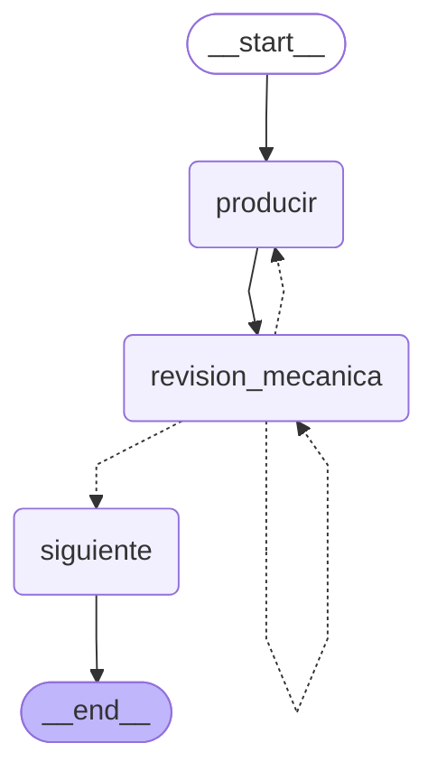

# Bloque 14 en el grafo

Generado desde el código con `runtime.dibujar`. `producir` y `siguiente` son de ejemplo.

La flecha punteada de vuelta a `producir` es el ciclo de corrección: solo ocurre si hay fallas, con dos rondas como
máximo. Los avisos no devuelven la pieza.
