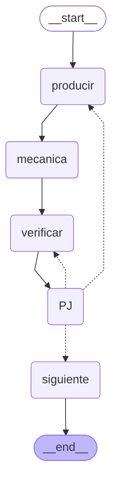

# Bloque 15 en el grafo

Generado desde el código con `runtime.dibujar`, con la línea de `pruebas/test_verificador.py`. `producir`,
`mecanica` y `siguiente` son de ejemplo.

Todas las rutas pasan por `PJ`, pero la puerta solo se detiene si el informe trae un J o un tipo 1. Si trae M o R,
vuelve a `producir`, con dos rondas como máximo. Un tipo 1 no vuelve: espera a Ricardo, porque hay que arreglar el
contexto, no la pieza.
