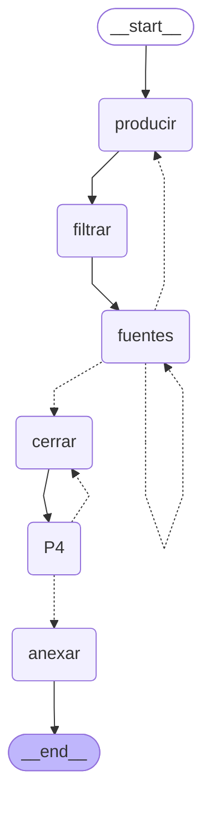

# Bloque 16 en el grafo

Generado desde el código con `runtime.dibujar`, con la línea de `pruebas/test_fuentes.py`. `producir` y `cerrar`
son de ejemplo.

`filtrar` le pasa al verificador solo las filas del registro que la pieza cita. Si hay corregidas o no
verificables, vuelve a `producir`, con dos rondas como máximo. `anexar` corre después de la puerta P4: al registro
solo entran fuentes de piezas aprobadas.
