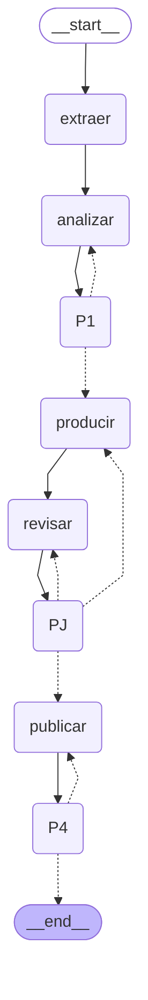

# Grafo de ejemplo

Línea de prueba con nodos falsos, generada con `runtime.dibujar`. Aún no es el sistema real.

- **Cajas con nombre de paso:** el trabajo. Las hace un script o un modelo.
- **P1, PJ, P4:** puertas. Ahí el flujo se detiene hasta que usted decida.
- **Flecha continua:** siempre pasa por ahí.
- **Flecha punteada:** depende de lo que usted decidió o de lo que encontró la revisión.

Cómo leerlo: `P1` hacia `analizar` es una devolución. `PJ` hacia `producir` es el ciclo de corrección, con dos
rondas como máximo. `PJ` solo se detiene si la revisión encontró algo que pide su juicio.
