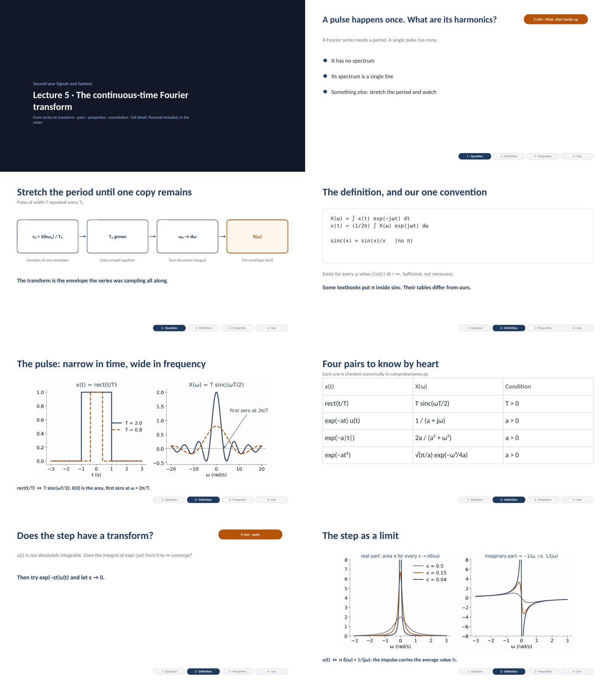

# Example: a Fourier transform lecture

A test lesson for second-year Signals and Systems, in British English. It is not official material from any university.

It was made on 1 November 2026 with Claude Code and an earlier version of this production system. The request was a signals course at British university level. The instance then set its own rules, notation and expensive errors.

| Stage | Files |
|---|---|
| Instructions | [`instructions.md`](instructions.md), `contexto/`, `plantillas/` (Spanish) |
| Source of the lesson | [`notes.md`](produccion/clase-05/notes.md), [`deck.json`](produccion/clase-05/deck.json), `graficas.py` |
| Outputs | [9-page PDF](produccion/clase-05/notes.pdf), [13-slide deck](produccion/clase-05/lecture-05-fourier-transform.pptx) |
| Checks | [`comprobaciones.py`](verificacion/comprobaciones.py): each numerical check must pass and must fail on its planted error |
| Review history | [`decisiones.md`](contexto/decisiones.md), [`bitacora.md`](evaluacion/bitacora.md) (Spanish) |

Three cold review rounds found formula checks that could not see a wrong sign or a missing absolute value. The answer was structural: the script now rejects any check without an error version, unless exempted with a reason.

Status: draft. The last change to the checks has no cold review. Deck generator and process files are not included.

Run the checks: `python3 verificacion/comprobaciones.py`
